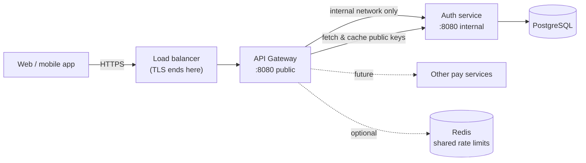

<div align="center">

# pay API Gateway

**The single public entry point for pay services — routing, edge security, rate limiting and resilience.**

[](https://openjdk.org/projects/jdk/21/)
[](https://spring.io/projects/spring-boot)
[](https://spring.io/projects/spring-cloud-gateway)
[](https://resilience4j.readme.io/)

[Architecture](#architecture) ·
[Architecture deep-dive](docs/ARCHITECTURE.md) ·
[Request flow](#request-flow) ·
[Quick start](#quick-start) ·
[Configuration](#configuration) ·
[Auth service changes](#required-changes-in-the-auth-service) ·
[Errors](#error-codes) ·
[Production](#production-checklist)

</div>

---

## Architecture

> [!TIP]
> For the full picture — the two gateway↔auth exchanges, per-request flow, failure handling and production topology — see **[docs/ARCHITECTURE.md](docs/ARCHITECTURE.md)**.



The gateway is the **only** public entry point. The auth service (and future services) are reachable **only** from the gateway's network.

### What the gateway does — and doesn't

| The gateway… | The services… |
|---|---|
| Rejects non-HTTPS, oversized bodies and floods **before** any service work | Keep their own endpoint limits (e.g. 10 logins/min) |
| **Pre-validates** JWTs: signature (via `/oauth2/jwks`), expiry, issuer, audience | **Still validate** every token, including session revocation (logout) — only the auth service knows that |
| Enforces coarse roles (`/api/v1/admin/**` needs `ROLE_ADMIN`) | Enforce fine-grained permissions (`@PreAuthorize`) |
| Sets the trusted client IP and protocol headers | Use them for rate limits and audit logs |
| Answers CORS (incl. preflight) and adds security headers | — |
| Opens a circuit breaker when a service fails, returning fast JSON errors | Recover without being flooded |
| **Never reads, changes or logs request bodies** | Decrypt E2E payloads themselves |
| **Never rewrites paths** | Rely on the original path inside the E2E seal (AAD) |

> [!IMPORTANT]
> **Encryption rule.** E2E encryption seals `METHOD|PATH|TIMESTAMP|NONCE` into each payload. If the gateway stripped or rewrote a path (e.g. `/auth/api/v1/login` → `/api/v1/login`), every encrypted request would fail with `AUTH-4003`. Routes therefore forward paths **unchanged** — never add `StripPrefix` or `RewritePath` to an encrypted route.

---

## Request flow

| # | Stage | Rejects with |
|:-:|---|---|
| 1 | `CorrelationIdWebFilter` — assign/propagate `X-Correlation-Id`, resolve real client IP + protocol | — |
| 2 | `HttpsEnforcementWebFilter` — HTTPS only (staging/prod) | `GW-4033` |
| 3 | `RequestSizeLimitWebFilter` — body ≤ 64 KB | `GW-4130` |
| 4 | `EdgeRateLimitWebFilter` — per-IP limit across all routes | `GW-4290` + `Retry-After` |
| 5 | Spring Security — CORS, security headers, JWT pre-validation, coarse roles | `AUTH-4012` / `AUTH-4011` / `AUTH-4030` |
| 6 | `ForwardedHeadersSanitizingFilter` — strip client `X-Forwarded-*`, set trusted values | — |
| 7 | Route → circuit breaker → auth service (path and body untouched) | `GW-5030` / `GW-5040` (fallback) |
| 8 | Dedupe CORS headers from the service; `AccessLogGlobalFilter` writes one line | — |

Gateway-generated errors use the **same JSON envelope** as the auth service:

```json
{ "success": false, "code": "GW-4290", "message": "Too many requests. Please slow down and try again later",
  "correlationId": "4aae433f-…", "timestamp": "2026-10-28T10:00:00Z" }
```

Auth errors reuse the auth service's `AUTH-*` codes, so front ends handle a 401/403 the same way whichever layer rejected it.

### Why the forwarded headers are rebuilt

The auth service trusts `X-Forwarded-For` for its per-IP login limits and audit trail. If clients could send their own value, they could pretend to be any IP and bypass the limits. The gateway therefore:

1. trusts only the address **its own load balancer** appended (`app.gateway.trusted-proxy-hops`),
2. removes every client-supplied `Forwarded`/`X-Forwarded-*`/`X-Real-IP` header,
3. sets exactly one `X-Forwarded-For` and one `X-Forwarded-Proto`.

---

## Routes

| Public path | Upstream | Access |
|---|---|---|
| `POST /api/v1/auth/signup`, `/login`, `/refresh` | auth service | public |
| `GET /api/v1/crypto/public-key`, `GET /oauth2/jwks` | auth service | public |
| `/api/v1/auth/logout`, `/logout-all`, `/api/v1/users/**` | auth service | valid JWT |
| `/api/v1/admin/**` | auth service | valid JWT + `ROLE_ADMIN` |
| `/dev/**`, service `/actuator/**` | — | **not routed** (denied) |
| anything else | — | denied (closed by default) |

To add a service, add one route in `RouteConfig` and its security rules in `SecurityConfig` — keep paths unchanged if it uses E2E encryption.

---

## Quick start

### Option A — run both locally

1. Start the **auth service** as usual on `http://localhost:8080`.
2. Start the gateway (dev profile, port **8000**):
   ```bash
   mvn spring-boot:run
   ```
3. Point every client at the **gateway** instead of the auth service:
   ```powershell
   java tools/E2EClient.java http://localhost:8000          # from the auth service repo
   ```
   In Postman, set the collection's `baseUrl` to `http://localhost:8000`.

### Option B — Docker (full stack)

With the auth service repo next to this one (`../EE-Security-Auth-Service`):

```bash
docker compose up --build
```

Gateway on `http://localhost:8000`; the auth service has **no published port** — exactly like production.

### Check it

```bash
curl -s http://localhost:8000/api/v1/crypto/public-key     # proxied, public
curl -s http://localhost:8000/api/v1/users/me              # 401 AUTH-4012 from the gateway (no token)
curl -s http://localhost:8000/dev/e2e/encrypt -X POST      # 403 — dev tools are never routed
```

---

## Configuration

| Variable | dev default | staging / prod | Purpose |
|---|---|---|---|
| `SPRING_PROFILES_ACTIVE` | `dev` | **required** | Environment |
| `SERVER_PORT` | `8000` | `8080` | Public port |
| `AUTH_SERVICE_URI` | `http://localhost:8080` | **required**, e.g. `http://auth-service:8080` | Internal auth service URL |
| `JWT_ISSUER` | `http://localhost:8080` | **required**, `https://…` | Must **equal** the auth service's issuer |
| `JWT_AUDIENCE` | `pay-api-dev` | **required** | Must **equal** the auth service's audience |
| `CORS_ALLOWED_ORIGINS` | localhost:3000, 5173 | **required**, `https://…` | Front-end origins (keep identical in the auth service) |
| `TRUSTED_PROXY_HOPS` | `0` | `1` | Proxies in front of the gateway (load balancer = 1) |
| `RATE_LIMIT_STORE` | `memory` | `memory` → `redis` with >1 instance | Shared edge counters |
| `REDIS_HOST` / `REDIS_PORT` / `REDIS_PASSWORD` / `REDIS_SSL` | — | with Redis | Redis connection |
| `MANAGEMENT_PORT` | same as server | `8091` (internal) | Health + Prometheus |

Fixed in properties: max body 64 KB, edge limit 300 requests/min per IP (1000 in dev), upstream timeouts (connect 2 s, response 10 s), circuit breaker (opens at 50 % failures over 20 calls, retries after 30 s).

The startup guard refuses staging/prod with HTTPS enforcement off, an `http://` issuer, localhost/wildcard CORS, edge rate limiting off, or actuator on the public port — printed as a clean *Description / Action* report.

> [!NOTE]
> The gateway is reactive (Netty event loops), so it doesn't use virtual threads — it already handles thousands of concurrent connections on a few threads. It never blocks: JWT keys are cached and Redis calls are non-blocking.

---

## Required changes in the auth service

| Change | Why |
|---|---|
| **`HttpsEnforcementFilter`: exempt `/oauth2/jwks`** (updated file provided) | The gateway fetches public keys over the internal network (plain HTTP inside the private network). JWKS holds only public keys. |
| **Remove the auth service's public port / load-balancer target** | Only the gateway may reach it — it trusts the gateway's `X-Forwarded-For` |
| **Keep `CORS_ALLOWED_ORIGINS` identical** in both services | The auth service still checks the forwarded `Origin`; the gateway removes the duplicate headers |
| **Front ends and partners use the gateway URL** | `baseUrl` = gateway; paths stay the same (`/api/v1/...`) |
| Keep the auth service's own rate limits, session checks, E2E | Defence in depth — the gateway pre-filters, the service decides |

> [!WARNING]
> The auth service trusts `X-Forwarded-For`. If it stays reachable directly from the internet, anyone could forge that header. Restrict it at the network level (security group, Kubernetes `NetworkPolicy`, or Docker network) to accept traffic **only from the gateway**.

---

## Error codes

| Code | Status | Meaning |
|---|:-:|---|
| `AUTH-4012` | 401 | No token |
| `AUTH-4011` | 401 | Invalid / expired token (client should refresh) |
| `AUTH-4030` | 403 | Missing role |
| `GW-4033` | 403 | HTTPS required |
| `GW-4040` | 404 | Not found |
| `GW-4050` | 405 | Method not allowed |
| `GW-4130` | 413 | Body larger than 64 KB |
| `GW-4290` | 429 | Edge rate limit — respect `Retry-After` |
| `GW-5000` | 500 | Unexpected gateway error |
| `GW-5020` | 502 | Upstream unreachable |
| `GW-5030` | 503 | Upstream down or circuit open — retry after `Retry-After` |
| `GW-5040` | 504 | Upstream timed out |

Every response carries `X-Correlation-Id`; the same id appears in the gateway access log and the auth service log.

---

## Project structure

```text
src/main/java/com/pay/gateway/
├── GatewayApplication.java
├── config/            RouteConfig, profile guard, startup failure analyzer
│   └── properties/    GatewayProperties (typed, validated)
├── constant/          GatewayConstants (headers, attributes)
│   └── enums/         GatewayErrorCode
├── controller/        FallbackController (circuit-breaker fallback)
├── dto/res/           ApiResponse (same envelope as the auth service)
├── exception/         GatewayErrorWebExceptionHandler, StartupConfigurationException
├── filter/            correlation id, HTTPS, body size, forwarded-header sanitizing, access log
├── ratelimit/         EdgeRateLimiter (in-memory | Redis), EdgeRateLimitWebFilter
├── security/          SecurityConfig (JWT pre-validation, CORS, headers, route rules)
└── util/              ClientIpResolver, JsonErrorWriter
```

---

## Production checklist

- [ ] Gateway is the **only** public target of the load balancer; auth service is internal-only
- [ ] `TRUSTED_PROXY_HOPS` matches the number of proxies in front (usually `1`)
- [ ] `JWT_ISSUER` / `JWT_AUDIENCE` identical to the auth service's
- [ ] `CORS_ALLOWED_ORIGINS` identical in gateway and auth service
- [ ] Auth service updated to exempt `/oauth2/jwks` from HTTPS enforcement
- [ ] `RATE_LIMIT_STORE=redis` once more than one gateway instance runs
- [ ] `MANAGEMENT_PORT` (8091) not exposed publicly; Prometheus scrapes it internally
- [ ] Alerts on `gateway.rate_limited`, circuit-breaker state (`resilience4j_circuitbreaker_state`), and 5xx rate
- [ ] At least two gateway instances behind the load balancer for availability

---

<div align="center">
<sub>Works with the <b>EE Security Auth Service</b> · Java 21 · Spring Cloud Gateway · secure by default</sub>
</div>